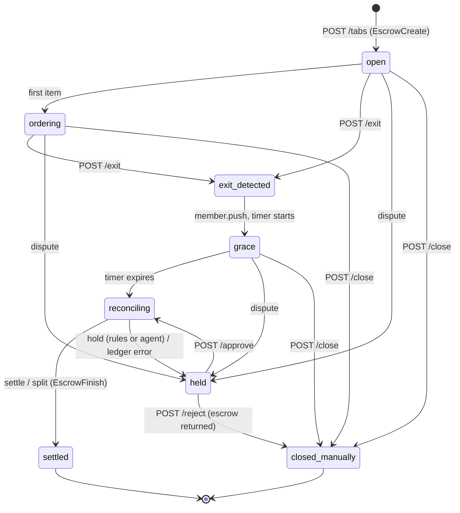
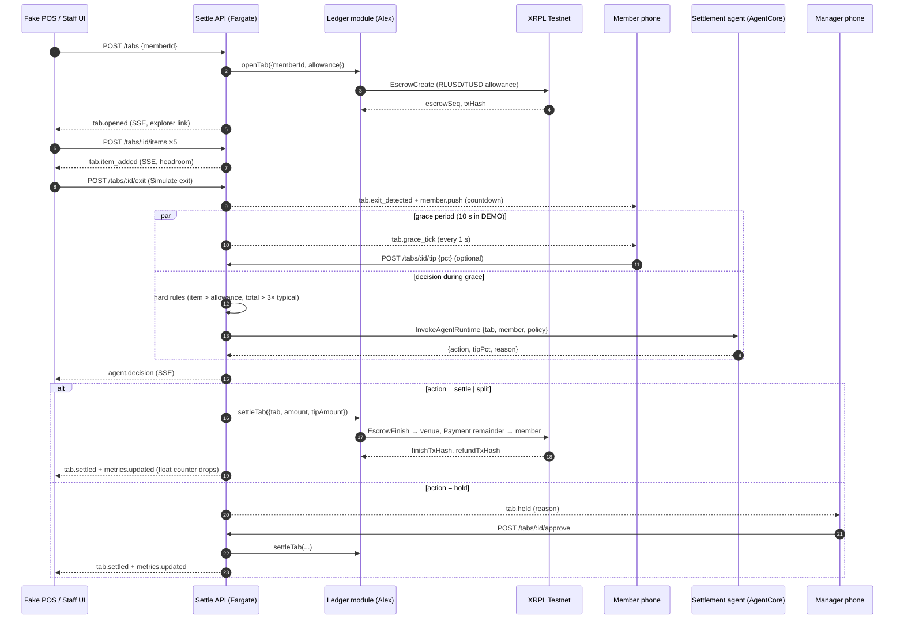
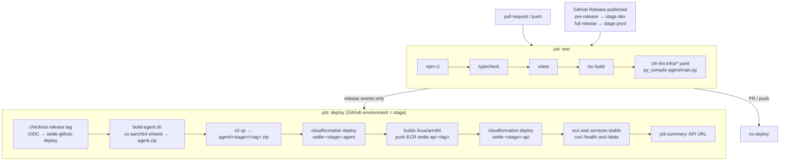

# Settle backend: architecture and AWS deployment

This is Epic 2 of the Settle Engineering Plan & Sprint Board (product spec: [../specs/SETTLE.md](../specs/SETTLE.md)): the API, tab state machine, fake POS, grace timer, settlement agent, manager approval, notifications (SSE) and metrics. It calls Alex's `ledger` module and never touches XRPL or a private key directly.

The AWS diagrams use the official AWS icon set and are generated as code by [diagrams/aws_diagrams.py](diagrams/aws_diagrams.py) (the [Diagrams](https://diagrams.mingrammer.com) library plus Graphviz). Regenerate them with `python diagrams/aws_diagrams.py` after changing `infra/`. The flow diagrams are Mermaid (`.mmd`, with rendered `.svg` copies), which GitHub renders inline.

## What gets deployed

Two CloudFormation stacks per stage, plus a one-time bootstrap stack. Stage `dev` deploys from a GitHub pre-release and `prod` from a full release.

### Resource inventory

| Stack | Template | Resources | Why |
|---|---|---|---|
| `settle-bootstrap` (once, by hand) | [infra/bootstrap.yaml](infra/bootstrap.yaml) | GitHub OIDC provider, `settle-github-deploy` role, S3 artifact bucket, ECR repo `settle-api` | Lets GitHub Actions deploy with no long-lived AWS keys |
| `settle-<stage>-agent` | [infra/agent.yaml](infra/agent.yaml) | `AWS::BedrockAgentCore::Runtime` (Python 3.13 code zip, arm64, HTTP protocol), `AWS::BedrockAgentCore::RuntimeEndpoint` `live`, runtime IAM role (Bedrock invoke, logs, X-Ray, metrics, workload identity) | Plan B5: one LLM call that returns `{action, tipPct, reason}` |
| `settle-<stage>-api` | [infra/api.yaml](infra/api.yaml) | VPC, 2 public subnets, IGW, ALB + listener rule, target group, CloudFront distribution, ECS cluster, Fargate task definition (ARM64, 0.5 vCPU, 1 GB) and service (exactly 1 task), task and execution roles, Secrets Manager `settle/<stage>/ledger-env`, log group | Plan B1–B9: REST + SSE with in-memory state, the grace timer, and the ledger module in-process |

### Design choices

- **One Fargate task, not Lambda.** Tab state lives in memory and SSE needs a long-lived connection (plan B1). The service runs exactly one task; deployments use `MaximumPercent: 100`, so the old task stops before the new one starts and state never splits. A deploy resets the demo state, which matches `POST /demo/reset`.
- **CloudFront in front of the ALB** gives an HTTPS URL with no domain or certificate. The ALB rejects any request that lacks the secret `X-Settle-Origin` header CloudFront adds. Caching and compression are off so SSE streams unbuffered, and a 15-second heartbeat stays under CloudFront's 60-second origin read timeout.
- **The agent runs during the grace period** (plan risk: "LLM latency makes the 4-second claim false"). `exit` starts the decision immediately, and the timer absorbs the latency.
- **The hold path never depends on the model.** Hard rules run in [src/agent/rules.ts](src/agent/rules.ts) before AgentCore is called: any item above the allowance, a total above `holdIfTotalOverTypicalX` times typical spend, or a total above the escrow. If AgentCore is slow (over 8 s), errors, or returns an invalid action, the API uses a deterministic fallback. That covers cut-list item "B5 LLM call (keep the hard rules)".
- **Never charge more than the escrow.** If the total plus tip exceeds the allowance, the tip is trimmed. If the items alone exceed it, the tab is held.
- **Keys stay in Alex's layer.** Ledger env vars (testnet seeds) live in one Secrets Manager JSON secret. ECS injects it as `LEDGER_ENV_JSON`, and `server.ts` expands it into `process.env` before loading `ledger/`. No key is ever in the repo or the image.

## Tab state machine (B2)

Illegal transitions return `409`. Every transition emits an event.

## Settlement flow (happy path and anomaly)

## CI/CD (deploys only on a GitHub Release)

Every PR and push runs the `test` job. **Nothing deploys until a Release is published.** A pre-release deploys `dev` and a full release deploys `prod`. The deploy job checks out the release tag and uses it to version the agent zip and the image. The deploy role trusts only the `dev` and `prod` GitHub environments, so no other workflow run can assume it.

Step by step:

## Code map

| Path | Plan story | What |
|---|---|---|
| [src/app.ts](src/app.ts) | B1, B3, B4, B6, B7, B9 | REST routes + `GET /events` SSE |
| [src/settleService.ts](src/settleService.ts) | B2–B9 | In-memory store, grace timers, settle / hold / approve / reject / close / reset |
| [src/stateMachine.ts](src/stateMachine.ts) | B2 | Allowed transitions |
| [src/agent/rules.ts](src/agent/rules.ts) | B5 | Hard hold rules + deterministic fallback |
| [src/agent/settlementAgent.ts](src/agent/settlementAgent.ts) | B5 | `InvokeAgentRuntime` with timeout and validation |
| [agent/main.py](agent/main.py) | B5 | Strands agent on AgentCore, Pydantic structured output |
| [src/ledger/](src/ledger/) | stub | Contract-identical stub (fake hashes after 3 s) and loader for Alex's module |
| [src/seed.ts](src/seed.ts) | B8 | 5 members, 6 open tabs, menu with the $900 bottle, policy |
| [src/types.ts](src/types.ts) | contract | Tab, events, ledger interface |
