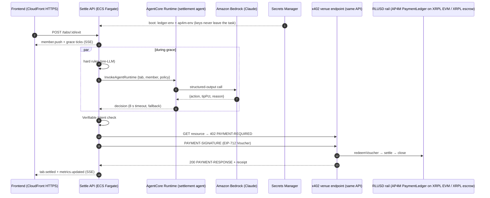

# Settle on AWS: AgentCore + x402/RLUSD

> **Brief:** *"Build a solution using our agentic payments stack (AgentCore + x402/RLUSD)."*
>
> **Settle:** an AI settlement agent on **Amazon Bedrock AgentCore Runtime** decides how each hospitality tab settles. The payment then executes over **x402**: the venue answers HTTP 402 and the agent pays with a signed Voucher that settles in **RLUSD** (Mastercard AP4M on the XRPL EVM sidechain, or a native XRPL token escrow). Everything is deployed with **CloudFormation** from **GitHub Actions** on each release.

---

## How the stack is used

| AWS / payments piece | What Settle does with it | Where |
|---|---|---|
| **AgentCore Runtime** | Hosts the **settlement agent** (Strands Agents, Python 3.13, arm64 code zip). For each tab it reads items, member history and policy, and returns structured output `{action: settle \| split \| hold, tipPct, reason}` validated by a Pydantic schema. | `api/agent/main.py`, `api/infra/agent.yaml` (`AWS::BedrockAgentCore::Runtime` + `RuntimeEndpoint "live"`) |
| **Amazon Bedrock (Claude)** | The model behind the agent, invoked through `BedrockModel` with least-privilege `bedrock:InvokeModel`. | `agent.yaml` runtime role |
| **InvokeAgentRuntime** | The API calls the agent **during the grace period** (the member's 10-second tip/dispute window), so model latency never delays settlement. It has an 8-second timeout and a deterministic fallback. | `api/src/agent/settlementAgent.ts` |
| **AgentCore Observability** | Agent traces and metrics through OpenTelemetry (`opentelemetry-instrument` entrypoint), sent to CloudWatch and X-Ray. | runtime role: X-Ray, `cloudwatch:PutMetricData` |
| **x402** | The venue is an x402 **payee facilitator**. `GET /x402/tabs/:id/resource` answers **402** with `PAYMENT-REQUIRED`. The agent retries with `PAYMENT-SIGNATURE` (an EIP-712 Voucher) and gets `200` + `PAYMENT-RESPONSE` and the tab receipt in one round trip. | `api/src/ap4m/merchant.ts`, `payer.ts`, `x402.ts` |
| **RLUSD** | Settlement asset. On **XRPL EVM** (chain 1449000) via Mastercard AP4M's PaymentLedger: the Channel cap is the member's allowance, and `settle()` pays RLUSD to the venue payout. On **native XRPL**, Alex's ledger module uses token escrow: EscrowCreate at open, EscrowFinish at settle. | `api/src/ap4m/*`, `ledger/` |
| **ECS Fargate (ARM64)** | One long-lived task runs the API: tab state machine, grace timers, SSE stream, x402 merchant and payer. A single task with `MaximumPercent: 100` deploys, so in-memory state never splits. | `api/infra/api.yaml` |
| **ALB + CloudFront** | HTTPS with no custom domain. SSE-friendly: ALB idle timeout 3600 s, CloudFront caching and compression off, 15 s heartbeats. The ALB returns 403 unless CloudFront's secret origin header is present. | `api.yaml` |
| **Secrets Manager** | `settle/<stage>/ledger-env` (XRPL seeds for the ledger module) and `settle/<stage>/ap4m-env` (AP4M Agent payment key, Merchant submitter key, team and merchant IDs), injected into the task as JSON and expanded at boot. | `api.yaml`, `api/src/env.ts` |
| **IAM** | Least-privilege roles: the task can only `InvokeAgentRuntime` on its own runtime. The runtime can invoke Bedrock and write logs, traces and metrics. GitHub deploys through OIDC (no long-lived AWS keys), and that role can only manage `settle-*` roles and can't modify itself. | `bootstrap.yaml`, `api.yaml`, `agent.yaml` |
| **CloudFormation + GitHub Actions** | Three templates: bootstrap, agent and api. CI runs on every PR (typecheck, 460+ tests with coverage thresholds, pytest, cfn-lint). **Deploys happen only when a GitHub Release is published**: a pre-release goes to `dev`, a full release to `prod`. | `.github/workflows/api.yml` |

## The design principle: the model decides, code signs

The agent on AgentCore **never holds a key and never moves money**. It returns a decision. The API then runs deterministic checks and signs only when all of them pass:

1. Hard rules run **before** the model: an item above the allowance, or a total above 3× the member's typical spend, is held without calling the LLM.
2. The member's **Verifiable Intent mandate** must cover the amount, payee and time.
3. The agent-side **x402 authority check** (network, asset, ledger, payTo, ≤ maximum, ≤ cap) runs before any signature.
4. The **AP4M PaymentLedger** enforces KYA and `settled ≤ redeemed ≤ cap` on-chain.

That is the same separation AgentCore Payments uses (a session spending limit enforced outside the model), applied to a rail it doesn't support yet. See the next section.

## Why x402 runs in the API rather than AgentCore Payments

AgentCore Payments (preview) handles x402 `exact` payments with Coinbase CDP or Stripe Privy wallets on Ethereum/Base and Solana. The Mastercard AP4M rail this hackathon uses is an x402 **`batch-settlement` voucher scheme on the XRPL EVM sidechain**: cumulative EIP-712 Vouchers against a funded Channel, redeemed by the merchant. No current AgentCore Payments connector signs that. So Settle implements the same pattern itself, with the same guarantees:

| AgentCore Payments concept | Settle equivalent |
|---|---|
| PaymentSession `maxSpendAmount` | AP4M Channel cap (on-chain) + Verifiable Intent max (member-signed) |
| Payment instrument (wallet) | AP4M Agent payment key in Secrets Manager, separate from the funding wallet |
| `ProcessPayment` on 402 | `payOverX402()`: verify the challenge, sign the Voucher, retry with `PAYMENT-SIGNATURE` |
| Payment observability | `x402.payment_required`, `x402.paid`, `ap4m.settled` events + CloudWatch logs |

When AgentCore Payments adds a connector for AP4M or XRPL EVM, the payer becomes one call and the rest of Settle is unchanged.

## Request flow on AWS

## Deployment pipeline

1. **Bootstrap (once):** `aws cloudformation deploy --template-file api/infra/bootstrap.yaml` creates the GitHub OIDC provider, the deploy role, the S3 artifact bucket and the ECR repository.
2. **Every PR and push:** the `test` job runs the typecheck, Vitest with coverage thresholds, pytest for the agent, the build and cfn-lint.
3. **Publish a release:** `gh release create v0.2.0-rc1 --prerelease` deploys `dev`, and `gh release create v0.2.0` deploys `prod`. The deploy job:
   - packages the agent for arm64 with `uv` and uploads it to S3;
   - deploys `settle-<stage>-agent`;
   - builds and pushes the arm64 API image to ECR;
   - deploys `settle-<stage>-api`;
   - waits for ECS to stabilize, smoke-tests `/health` and `/state`, and prints the HTTPS URL.

## Operating it

| Concern | How |
|---|---|
| Configuration | CloudFormation parameters `LedgerMode` (`stub \| module \| ap4m`), `Ap4mNetwork` (`simulated \| live`), `IntentMode`, `Demo`, set from GitHub repository variables |
| Secrets | `aws secretsmanager put-secret-value --secret-id settle/dev/ap4m-env --secret-string '{...}'`, then publish a release |
| Logs and traces | `/settle/<stage>/api` (ECS) and `/aws/bedrock-agentcore/runtimes/*` plus X-Ray (agent) |
| Rollback | Re-run an older release's deploy; images and agent zips are tagged by release |
| Cost | About $35–45 a month per running stage (Fargate ARM, ALB, CloudFront), plus per-use AgentCore and Bedrock. Tear down `settle-<stage>-api` after the event |

## What's real today

- AgentCore Runtime, agent and CloudFormation templates: written and linted with cfn-lint, which validates the `AWS::BedrockAgentCore::*` schemas. CI is green on GitHub. The first AWS deploy runs when the first release is published.
- x402 + RLUSD settlement: working end to end in simulated AP4M mode with real EIP-712 signatures, covered by integration tests. The live XRPL EVM client is implemented and tested against a faked node and service, pending the team's AP4M onboarding keys.
