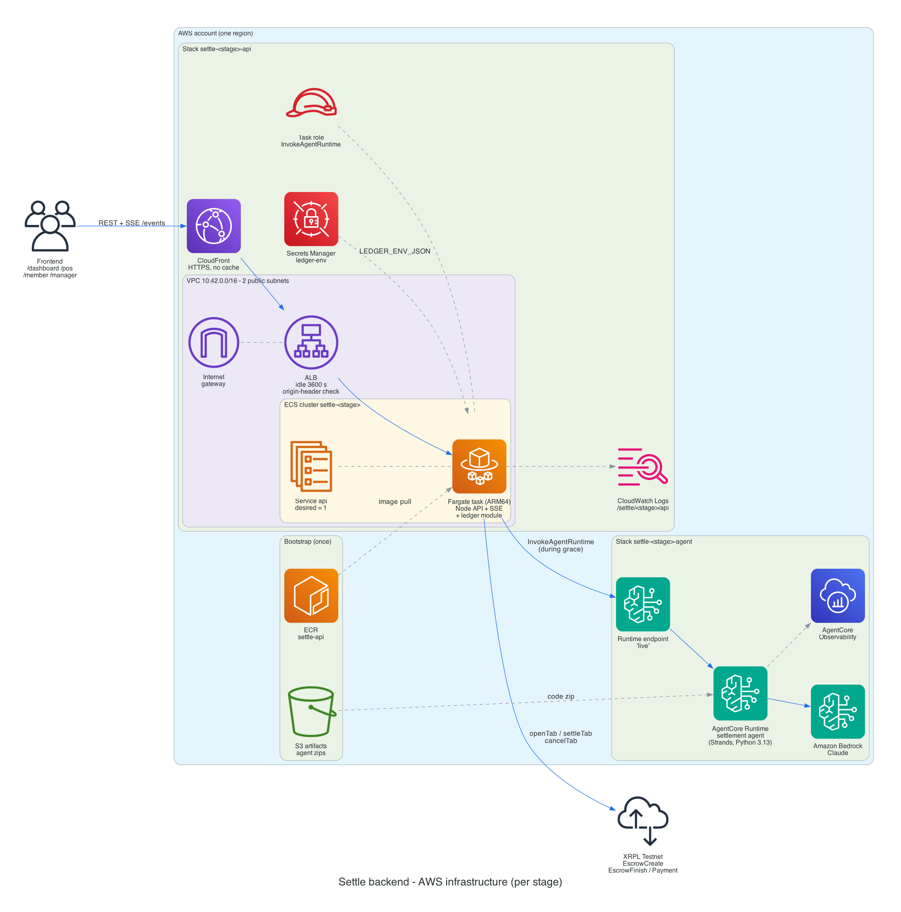
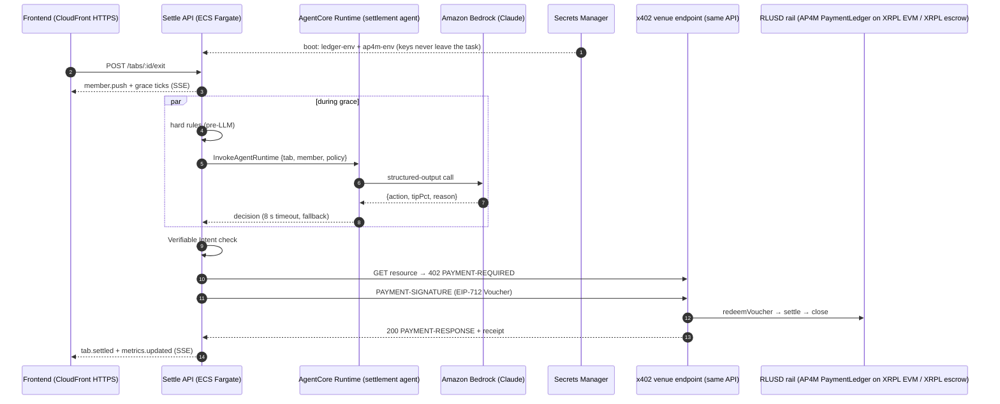
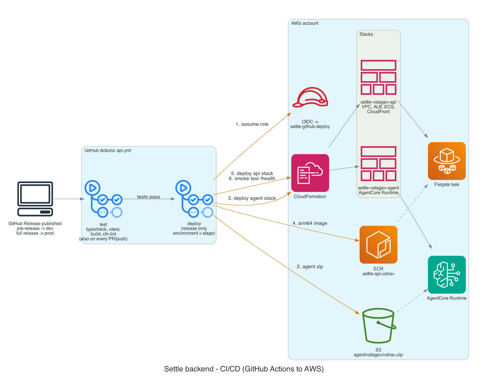

# Settle on AWS: AgentCore + x402/RLUSD

> **Brief:** *"Build a solution using our agentic payments stack (AgentCore + x402/RLUSD)."*
>
> **Settle:** an AI settlement agent on **Amazon Bedrock AgentCore Runtime** decides how each hospitality tab settles. The payment then executes over **x402**: the venue answers HTTP 402 and the agent pays with a signed Voucher that settles in **RLUSD** (Mastercard AP4M on the XRPL EVM sidechain, or a native XRPL token escrow). Everything is deployed with **CloudFormation** from **GitHub Actions** on each release.

---

## How the stack is used

| AWS / payments piece | What Settle does with it | Where |
|---|---|---|
| **AgentCore Runtime** | Hosts the **settlement agent** (Strands Agents, Python 3.13, arm64 code zip). For each tab it reads items, member history and policy, and returns structured output `{action: settle \| split \| hold, tipPct, reason}` validated by a Pydantic schema. | `api/agent/main.py`, `api/infra/agent.yaml` (`AWS::BedrockAgentCore::Runtime` + `RuntimeEndpoint "live"`) |
| **Amazon Bedrock (Claude)** | The model behind the agent, invoked through `BedrockModel` with least-privilege `bedrock:InvokeModel`. | `agent.yaml` runtime role |
| **InvokeAgentRuntime** | The API calls the agent **during the grace period** (the member's 10-second tip/dispute window), so model latency never delays settlement. It has an 8-second timeout and a deterministic fallback. | `api/src/agent/settlementAgent.ts` |
| **AgentCore Observability** | Agent traces and metrics through OpenTelemetry (`opentelemetry-instrument` entrypoint), sent to CloudWatch and X-Ray. | runtime role: X-Ray, `cloudwatch:PutMetricData` |
| **x402** | The venue is an x402 **payee facilitator**. `GET /x402/tabs/:id/resource` answers **402** with `PAYMENT-REQUIRED`. The agent retries with `PAYMENT-SIGNATURE` (an EIP-712 Voucher) and gets `200` + `PAYMENT-RESPONSE` and the tab receipt in one round trip. | `api/src/ap4m/merchant.ts`, `payer.ts`, `x402.ts` |
| **RLUSD** | Settlement asset. On **XRPL EVM** (chain 1449000) via Mastercard AP4M's PaymentLedger: the Channel cap is the member's allowance, and `settle()` pays RLUSD to the venue payout. On **native XRPL**, Alex's ledger module uses token escrow: EscrowCreate at open, EscrowFinish at settle. | `api/src/ap4m/*`, `ledger/` |
| **ECS Fargate (ARM64)** | One long-lived task runs the API: tab state machine, grace timers, SSE stream, x402 merchant and payer. A single task with `MaximumPercent: 100` deploys, so in-memory state never splits. | `api/infra/api.yaml` |
| **ALB + CloudFront** | HTTPS with no custom domain. SSE-friendly: ALB idle timeout 3600 s, CloudFront caching and compression off, 15 s heartbeats. The ALB returns 403 unless CloudFront's secret origin header is present. | `api.yaml` |
| **Secrets Manager** | `settle/<stage>/ledger-env` (XRPL seeds for the ledger module) and `settle/<stage>/ap4m-env` (AP4M Agent payment key, Merchant submitter key, team and merchant IDs), injected into the task as JSON and expanded at boot. | `api.yaml`, `api/src/env.ts` |
| **IAM** | Least-privilege roles: the task can only `InvokeAgentRuntime` on its own runtime. The runtime can invoke Bedrock and write logs, traces and metrics. GitHub deploys through OIDC (no long-lived AWS keys), and that role can only manage `settle-*` roles and can't modify itself. | `bootstrap.yaml`, `api.yaml`, `agent.yaml` |
| **CloudFormation + GitHub Actions** | Three templates: bootstrap, agent and api. CI runs on every PR (typecheck, 460+ tests with coverage thresholds, pytest, cfn-lint). **Deploys happen only when a GitHub Release is published**: a pre-release goes to `dev`, a full release to `prod`. | `.github/workflows/api.yml` |

## The design principle: the model decides, code signs

The agent on AgentCore **never holds a key and never moves money**. It returns a decision. The API then runs deterministic checks and signs only when all of them pass:

1. Hard rules run **before** the model: an item above the allowance, or a total above 3× the member's typical spend, is held without calling the LLM.
2. The member's **Verifiable Intent mandate** must cover the amount, payee and time.
3. The agent-side **x402 authority check** (network, asset, ledger, payTo, ≤ maximum, ≤ cap) runs before any signature.
4. The **AP4M PaymentLedger** enforces KYA and `settled ≤ redeemed ≤ cap` on-chain.

That is the same separation AgentCore Payments uses (a session spending limit enforced outside the model), applied to a rail it doesn't support yet. See the next section.

## Why x402 runs in the API rather than AgentCore Payments

AgentCore Payments (preview) handles x402 `exact` payments with Coinbase CDP or Stripe Privy wallets on Ethereum/Base and Solana. The Mastercard AP4M rail this hackathon uses is an x402 **`batch-settlement` voucher scheme on the XRPL EVM sidechain**: cumulative EIP-712 Vouchers against a funded Channel, redeemed by the merchant. No current AgentCore Payments connector signs that. So Settle implements the same pattern itself, with the same guarantees:

| AgentCore Payments concept | Settle equivalent |
|---|---|
| PaymentSession `maxSpendAmount` | AP4M Channel cap (on-chain) + Verifiable Intent max (member-signed) |
| Payment instrument (wallet) | AP4M Agent payment key in Secrets Manager, separate from the funding wallet |
| `ProcessPayment` on 402 | `payOverX402()`: verify the challenge, sign the Voucher, retry with `PAYMENT-SIGNATURE` |
| Payment observability | `x402.payment_required`, `x402.paid`, `ap4m.settled` events + CloudWatch logs |

When AgentCore Payments adds a connector for AP4M or XRPL EVM, the payer becomes one call and the rest of Settle is unchanged.

## Request flow on AWS

## Deployment pipeline

1. **Bootstrap (once):** `aws cloudformation deploy --template-file api/infra/bootstrap.yaml` creates the GitHub OIDC provider, the deploy role, the S3 artifact bucket and the ECR repository.
2. **Every PR and push:** the `test` job runs the typecheck, Vitest with coverage thresholds, pytest for the agent, the build and cfn-lint.
3. **Publish a release:** `gh release create v0.2.0-rc1 --prerelease` deploys `dev`, and `gh release create v0.2.0` deploys `prod`. The deploy job:
   - packages the agent for arm64 with `uv` and uploads it to S3;
   - deploys `settle-<stage>-agent`;
   - builds and pushes the arm64 API image to ECR;
   - deploys `settle-<stage>-api`;
   - waits for ECS to stabilize, smoke-tests `/health` and `/state`, and prints the HTTPS URL.

## Operating it

| Concern | How |
|---|---|
| Configuration | CloudFormation parameters `LedgerMode` (`stub \| module \| ap4m`), `Ap4mNetwork` (`simulated \| live`), `IntentMode`, `Demo`, set from GitHub repository variables |
| Secrets | `aws secretsmanager put-secret-value --secret-id settle/dev/ap4m-env --secret-string '{...}'`, then publish a release |
| Logs and traces | `/settle/<stage>/api` (ECS) and `/aws/bedrock-agentcore/runtimes/*` plus X-Ray (agent) |
| Rollback | Re-run an older release's deploy; images and agent zips are tagged by release |
| Cost | About $35–45 a month per running stage (Fargate ARM, ALB, CloudFront), plus per-use AgentCore and Bedrock. Tear down `settle-<stage>-api` after the event |

## AWS Well-Architected review

We reviewed Settle against the six pillars of the [AWS Well-Architected Framework](https://docs.aws.amazon.com/wellarchitected/latest/framework/welcome.html), and against the Generative AI Lens for the agent. For each pillar: what is already built (with the file that proves it), and the known gaps with the next step. A hackathon build has gaps, and we would rather name them than hide them.

### 1. Operational excellence

| Built | Evidence |
|---|---|
| Everything is infrastructure as code: three CloudFormation stacks (bootstrap, agent, api), linted with cfn-lint in CI | `api/infra/*.yaml`, `.github/workflows/api.yml` |
| Small, reversible changes. Every PR and push runs the typecheck, 530+ tests with coverage thresholds (95% lines), the pytest agent tests and cfn-lint. Deploys happen only on a published GitHub Release, tagged by release, so rolling back means re-running an older release | `api/vitest.config.ts`, `api.yml` |
| Deployment safety: the ECS deployment circuit breaker auto-rolls back a failed task, and a post-deploy smoke test hits `/health` and `/state` | `api.yaml` (`DeploymentCircuitBreaker`), `api.yml` |
| Observability: structured JSON logs to CloudWatch (30-day retention) and ECS Container Insights. The agent emits OpenTelemetry traces and metrics through AgentCore Observability to X-Ray and CloudWatch | `api.yaml`, `agent.yaml` (`opentelemetry-instrument`) |
| Business events double as an audit trail. Every state change, agent decision, Voucher and settlement is an SSE event carrying its transaction hashes | `api/src/settleService.ts`, `api/README.md` (event table) |
| Runbooks: setup, deploy, secret rotation, teardown and the live-ledger test procedure | `api/README.md` |

**Gaps, then next steps:** no CloudWatch alarms or dashboard yet; add alarms on ECS task health, 5xx rate, `InvokeAgentRuntime` errors and fallback rate. There is no load test; add one for SSE fan-out and concurrent settlements before production.

### 2. Security

| Built | Evidence |
|---|---|
| **No long-lived AWS credentials.** GitHub Actions assumes the deploy role through OIDC, and only from the `dev` and `prod` GitHub environments. The role can manage only `settle-*` IAM roles and explicitly can't modify itself | `bootstrap.yaml` (`NoSelfEscalation`) |
| **Least-privilege runtime roles.** The ECS task can only call `InvokeAgentRuntime` on its own runtime. The AgentCore runtime role is limited to Bedrock invoke, its own log groups, X-Ray and the `bedrock-agentcore` metrics namespace. The execution role reads only the two Settle secrets | `api.yaml`, `agent.yaml` |
| **Secrets never in code or images.** XRPL seeds and AP4M keys live in Secrets Manager and are injected at runtime. `.env` files are git-ignored and docker-ignored. The issuer key is never deployed | `api.yaml`, `api/Dockerfile.dockerignore`, `api/src/env.ts` |
| **The model never holds a key.** AgentCore returns a decision only; signing is deterministic code. A test asserts that no private key is ever sent to the AP4M service | `api/src/agent/settlementAgent.ts`, `api/test/ap4m.live.test.ts` |
| **Defense in depth on payments.** Seven independent checks run before value moves: member-signed Verifiable Intent mandate, pre-LLM hard rules, manager hold, agent-side x402 authority check, on-chain cap, KYA registry, idempotent redemption | `submission/MASTERCARD.md` (trust and control) |
| **Network.** CloudFront enforces HTTPS (redirect). The ALB returns 403 without CloudFront's origin header. The task security group admits only the ALB on 8080 | `api.yaml` |
| **Supply chain.** ECR scan on push, the container runs as the non-root `node` user, and dependencies are pinned exactly with lockfiles | `bootstrap.yaml`, `api/Dockerfile`, `api/package.json` |
| **Input validation.** Every route validates its body. Agent output is schema-checked, and the tip is clamped to 0–30% | `api/src/app.ts`, `parseDecision` |

**Gaps, then next steps:**
- **No end-user authentication on the API** (out of scope in the engineering plan). Add Cognito or JWT authorization at CloudFront or the ALB, with role-based access so only managers can approve.
- **No AWS WAF.** Attach a managed rule set to CloudFront.
- **Weak origin secret.** The ALB origin header is derived from the stack ID; replace it with a rotated Secrets Manager value or CloudFront VPC origins.
- **CORS defaults to `*`.** Pin it to the frontend origin.
- **Tasks run in public subnets** (no NAT, for cost). Move them to private subnets with VPC endpoints.
- **The deploy role uses PowerUserAccess.** Narrow it to the services the stacks use.
- **Secrets use the AWS-managed KMS key.** Move to a customer-managed key with rotation for production.

### 3. Reliability

| Built | Evidence |
|---|---|
| **Graceful degradation of the AI dependency.** AgentCore calls have an 8-second timeout. On error, timeout or invalid output, a deterministic fallback decides, so settlement never depends on model availability | `api/src/agent/settlementAgent.ts`, `test/settlementAgent.test.ts` |
| **Fail safe on money.** A ledger or AP4M failure moves the tab to `held` with `hold.source: "ledger"` and the error in `hold.code` (`LEDGER_TIMEOUT`, `ESCROW_NOT_FOUND`, …), for manager retry. It is never silently dropped or double-charged | `settleService.ts`, `test/integration/ledger.contract.test.ts` |
| **Idempotency.** An x402 redemption is keyed by voucher digest, so a retry returns the same claim and never redeems twice. Each tab invoice is payable once | `api/src/ap4m/merchant.ts`, `test/ap4m.x402.test.ts` |
| **Race safety.** A late agent decision after a dispute or reset is discarded, and timers are cleared on every terminal transition | `test/settleService.test.ts` (race conditions) |
| **Health-checked compute.** ALB and container health checks, with ECS replacing unhealthy tasks. The ALB spans two Availability Zones. The agent runs on managed, serverless AgentCore Runtime | `api.yaml` |
| **Testnet weather.** `AP4M_NETWORK=simulated` and the stub ledger keep the demo runnable when a testnet is slow or down. SSE supports `?replay=1` after reconnects | `api/src/config.ts`, `api/src/app.ts` |

**Gaps, then next steps:**
- **Single point of failure.** Tab state is in memory on one task (a deliberate hackathon trade-off for SSE simplicity, enforced with `MaximumPercent: 100`), so a restart loses open tabs. Move tab state to DynamoDB and fan events out through a shared channel (for example ElastiCache or EventBridge), then run two or more tasks across AZs.
- **No recovery of in-flight settlements after a crash.** The ledger is the source of truth: reconcile from it on boot.

### 4. Performance efficiency

| Built | Evidence |
|---|---|
| **Latency hidden by design.** The agent is invoked at exit, during the member's 10-second grace window, so model latency never adds to time-to-settle | `settleService.ts` (`exit`) |
| **Right-sized, purpose-fit compute.** Graviton (ARM64) for both Fargate and AgentCore Runtime. One structured LLM call per tab, no agent loop or tools. Hard rules skip the model entirely for obvious holds | `api.yaml`, `agent.yaml`, `api/src/agent/rules.ts` |
| **Push, not poll.** Clients get every change over SSE through CloudFront (caching and compression off for streams, 15 s heartbeats) | `api/src/app.ts`, `api.yaml` |
| **Fast settlement rails.** XRPL validates in seconds, with escrow finish and refund in one atomic Batch when available. AP4M settles one x402 round trip per tab | `ledger/src/ledger.ts`, `api/src/ap4m/` |
| **Model choice is a parameter.** `ModelId` can be tuned without code changes | `agent.yaml` |

**Gaps, then next steps:** measure p95 decision latency and the fallback rate in CloudWatch, and tune the model and timeout against them.

### 5. Cost optimization

| Built | Evidence |
|---|---|
| About $35–45 a month per running stage: one 0.5 vCPU / 1 GB Graviton Fargate task (Graviton is cheaper than x86), an ALB, and CloudFront `PriceClass_100`. **No NAT gateway** | `api.yaml` |
| Pay-per-use AI: AgentCore Runtime and Bedrock bill per invocation, with no idle agent fleet. Hard rules avoid paying for model calls on obvious holds | `agent.yaml`, `rules.ts` |
| Lifecycle limits: ECR keeps the last 20 images, agent zips expire after 30 days, and logs are retained for 30 days | `bootstrap.yaml`, `api.yaml` |
| Release-gated deploys (no deploy on every push), and stages are torn down after the event | `api.yml`, `api/README.md` |

**Gaps, then next steps:** add cost-allocation tags and an AWS Budgets alarm per stage. For production, compare Fargate Spot (once state is externalized) with a Savings Plan.

### 6. Sustainability

| Built | Evidence |
|---|---|
| Energy-efficient Graviton processors for all compute, and a single small task sized to the demo | `api.yaml`, `agent.yaml` |
| Serverless agent runtime: no always-on model host | `agent.yaml` |
| Minimal data retention (30-day logs and artifacts), regional CloudFront edge only, no NAT, and stages torn down when idle | `api.yaml`, `bootstrap.yaml` |
| An efficient AI pattern: one short structured call per tab, with deterministic rules first | `agent/main.py`, `rules.ts` |

**Gaps, then next steps:** scale the dev stage to zero outside demo hours (scheduled `DesiredCount: 0`).

### Generative AI Lens: responsible agent design

| Concern | How Settle handles it |
|---|---|
| **Bounded autonomy** | The model chooses only `settle / split / hold` and a tip. It can't change amounts, payees or limits, which are bound by the member's mandate and the on-chain cap |
| **Human in the loop** | Every hold goes to a manager. Members can dispute during grace, and hard rules guarantee the hold path without the model |
| **Output validation** | A Pydantic schema runs on AgentCore and the API re-validates the action and clamps the tip. Anything invalid falls back to deterministic logic |
| **Prompt-injection surface** | The agent receives only structured tab data (items, totals, history, policy) with no tools and no free-text from untrusted parties. Even a manipulated decision can't exceed the mandate or cap |
| **Traceability** | AgentCore traces for each invocation, plus `agent.decision` events recording which source decided (`rules`, `agent` or `fallback`) and why |

### Risk register (top 5)

| # | Risk | Pillar | Likelihood / impact | Mitigation today | Next step |
|---|---|---|---|---|---|
| 1 | Task restart loses open tabs | Reliability | Medium / High | Single task, rolling replacement, ledger is the source of truth | DynamoDB state + reconcile on boot |
| 2 | Unauthenticated API | Security | High / Medium | Demo-only stage; payments bound by mandate + cap | Cognito/JWT, manager roles, WAF |
| 3 | Model or AgentCore unavailable | Reliability | Low / Low | 8 s timeout + deterministic fallback | Alarm on fallback rate |
| 4 | Testnet slow or down at demo time | Reliability | Medium / High | Simulated AP4M, stub ledger, backup video | — |
| 5 | Key compromise | Security | Low / High | Secrets Manager, separate funding and payment keys, caps limit the blast radius | Customer-managed KMS, rotation, private subnets |

## What's real today

- AgentCore Runtime, agent and CloudFormation templates: written and linted with cfn-lint, which validates the `AWS::BedrockAgentCore::*` schemas. CI is green on GitHub. The first AWS deploy runs when the first release is published.
- x402 + RLUSD settlement: working end to end in simulated AP4M mode with real EIP-712 signatures, covered by integration tests. The live XRPL EVM client is implemented and tested against a faked node and service, pending the team's AP4M onboarding keys.
