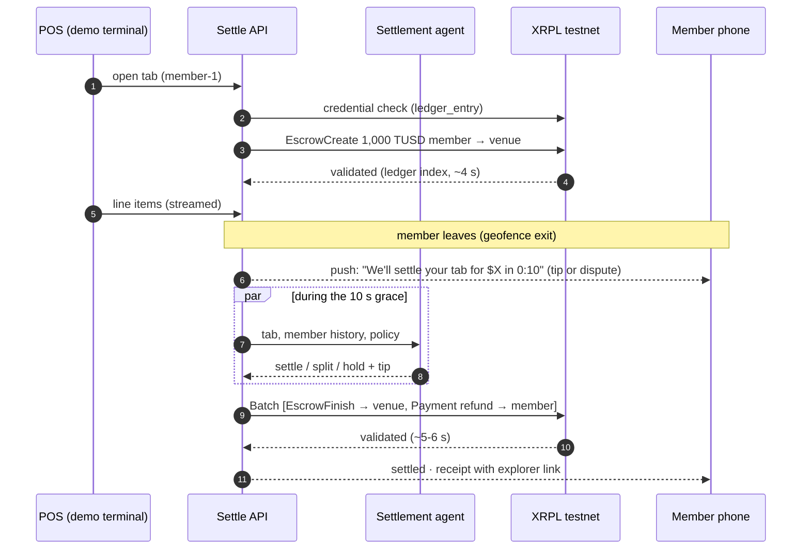

# Settle on the XRP Ledger

> **Settle:** private clubs, hotels and restaurant groups carry six-figure member tabs that turn into month-end receivables. With Settle, a member's tab is **escrowed on XRPL when it opens**, an AI agent settles it **the moment they walk out**, and the venue is paid in one validated ledger, with the unspent allowance back to the member in the same all-or-nothing Batch. Membership itself is an **XRPL Credential**, so only club members can open a tab.

| | |
|---|---|
| Repo | `[REPO URL]` (today: https://github.com/jannahsherif/XRPL-hackathon) |
| Video | `[VIDEO URL]` |
| Run it | [README.md › Run the demo](../README.md#run-the-demo) |
| Testnet run | Both scenarios, 2026-10-25 05:32 UTC, `LEDGER_MODE=module` ([links below](#proof-on-testnet)) |

---

## How Settle uses the XRP Ledger

| XRPL feature | What Settle does with it | Where |
|---|---|---|
| **Token escrow** (TokenEscrow, XLS-85) | Opening a tab escrows the member's allowance (for example 1,000 TUSD) from the member to the venue. `FinishAfter` = open + 20 s, `CancelAfter` = open + 8 h. Nothing is pre-authorized on a card, and the venue can't be paid more than the escrow holds | `ledger/src/ledger.ts` `openTab` |
| **Batch** (all-or-nothing) | When anything is left to refund, settling is one Batch: EscrowFinish (allowance to the venue) + Payment (the unspent part back to the member). Either both validate or neither does. If the Batch fails for any reason it falls back to the two in sequence; a fully spent tab is a single EscrowFinish | `ledger/src/ledger.ts` `settleTab` |
| **Credentials** (XLS-70) | The club issues each member a `CLUB_MEMBER` credential (`CredentialCreate`), the member accepts it (`CredentialAccept`), and `openTab` checks it on the ledger first. Revoking it (`CredentialDelete`) stops new tabs: the API answers `403 NOT_CREDENTIALED` | `ledger/src/credentials.ts`, `api/src/settleService.ts` |
| **Issued token + trust lines** | `TUSD`, issued by the team's issuer with *Allow Trust Line Locking* set. It stands in for RLUSD because the testnet RLUSD issuer doesn't set that flag, which token escrow requires (`npm run check:rlusd` re-checks). One constant switches it | `ledger/src/config.ts`, `ledger/README.md` |
| **Validated-ledger timing** | Every result carries `submittedAt` and `validatedAt`. The dashboard shows "validated · 5.6 s" and reads the ledger index and fee back from testnet by hash | `ledger/src/submit.ts`, `web/src/lib/xrpl.ts` |
| **Explorer-verifiable receipts** | Each settled tab carries its finish, refund and Batch hashes; the dashboard, the member's receipt and the manager phone link to the testnet explorer | `api/src/types.ts` `Settlement`, `web/` |

## The design principle: the model decides, the ledger enforces

The settlement agent only returns `settle`, `split` or `hold` and a tip. It never holds a key. Money moves only through the ledger module, and the ledger bounds it:

1. **Credential gate:** no accepted `CLUB_MEMBER` credential, no tab.
2. **Escrow cap:** a tab can never settle for more than its escrowed allowance; the tip is trimmed to fit.
3. **Hard rules before the model:** an item above the allowance, or a total above 3× the member's typical spend, is held by code. The $900 bottle on a member who usually spends $120 never reaches the LLM.
4. **Human in the loop:** held tabs wait on the manager's phone. Nothing moves on-ledger until a human approves.
5. **All-or-nothing settle:** the venue's payment and the member's refund validate in one Batch, or not at all.

## The flow

## Proof on testnet

From the acceptance run against `LEDGER_MODE=module` on 2026-10-25 (`web/scripts/acceptance.mjs`), followed by `npm run demo:reset`:

**Scenario 1: walk out, settle.** Eleanor Vance (member-1) orders five items ($103.00), leaves, and the agent settles with a 20% tip: 123.60 TUSD to the venue, 876.40 back, one Batch validated in 5.6 s.

| Step | Transaction |
|---|---|
| EscrowCreate, 1,000 TUSD (ledger 21,805,593, validated in 3.7 s) | [2C13…C032](https://testnet.xrpl.org/transactions/2C13710291EB5C5437F879158308B9DD93826FE370B4C8283D646B6D86A2C032) |
| Batch (ledger 21,805,607) | [FBF1…96DE](https://testnet.xrpl.org/transactions/FBF1C905330ECCC696B5A8F6AAB4607ACF51DB36147697C1BEC9ECF574DF96DE) |
| ↳ EscrowFinish, 123.60 to the venue | [DB76…C6EE](https://testnet.xrpl.org/transactions/DB76F38BEBB8ED371A1DC01A54FA1A06BF9658509C45465F48DC9E18A7F0C6EE) |
| ↳ Payment, 876.40 refund to the member | [602C…D0C3](https://testnet.xrpl.org/transactions/602CD2D3863BCB4EBA384ECB6915D3578ED51647063C5AA001347DD87FBAD0C3) |

**Scenario 2: the $900 bottle.** Jordan Pike (member-5) orders a $900 bottle; the hard rule holds it (`OVER_TYPICAL_SPEND`, 7.5× his typical $120); the manager approves; it settles for the full 1,000 TUSD (the tip trimmed to what the escrow holds) in 6.7 s.

| Step | Transaction |
|---|---|
| EscrowCreate, 1,000 TUSD (ledger 21,805,608, validated in 2.6 s) | [16B1…6374](https://testnet.xrpl.org/transactions/16B1D479331B121A071574E7EEBEC25F2DD895C166BE8EA96F552C4E55756374) |
| EscrowFinish after approval, 1,000 to the venue (ledger 21,805,623) | [3F03…5BCD](https://testnet.xrpl.org/transactions/3F031ED98D3AB369FF4DFAAF328B03C64F1C0F33ACED9455C30F4250152D5BCD) |

Accounts: [venue](https://testnet.xrpl.org/accounts/racCSEur13ufSxQozezdFKrvykwyWnjGE3) · [member-1](https://testnet.xrpl.org/accounts/rNNmUJNWVvnwyzwiR5SuohEX5VKVuTZani) · [member-5](https://testnet.xrpl.org/accounts/rE3UB34tKGhyJ34zqMsBrpSpzchYe7DQbs) · [TUSD issuer](https://testnet.xrpl.org/accounts/r2GfPNjV5vW1Gz2W9n4szD9nXJLduVEwe)

## What's real vs simulated

| Piece | Real or simulated |
|---|---|
| Tab escrow, settle Batch, refund | **Real**, XRPL testnet (`LEDGER_MODE=module`) |
| `CLUB_MEMBER` credentials and the open-tab gate | **Real**, issued and accepted on testnet |
| TUSD | **Real** testnet issued token; a stand-in for RLUSD (see above) |
| Ledger index, fee and validation time on the dashboard | **Real**, read back from testnet by hash |
| Hard-rule holds and manager approval | **Real** code paths in the API |
| Settlement agent | Implemented for Amazon Bedrock AgentCore (`api/agent/main.py`); the stage demo runs the API's deterministic fallback (`AGENT_MODE=local`): the same hard rules, then settle with the policy's default tip |
| Member leaving (geofence) | **Simulated** with the dashboard's "Simulate exit · DEMO" button |
| POS | **Demo terminal**, standing in for Toast or Lightspeed |
| Push notification and phones | **Simulated** in the browser (phone frames) |
| Funding rail (card top-ups) and payout rail | **SIMULATED**, labelled so on the dashboard |
| Outstanding member balances ($342,180) | Seeded figure; it drops by the real `toVenue` of each settle |
| Stub mode (`LEDGER_MODE=stub`) | Fallback for a slow testnet: same screens, badge reads STUB; it replays the hashes above so explorer links still resolve |
