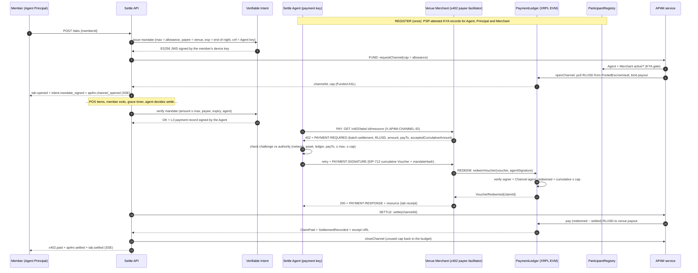
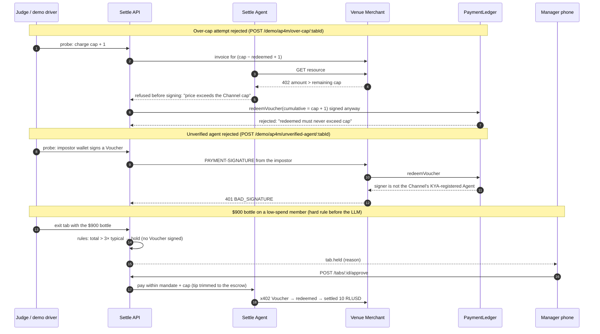
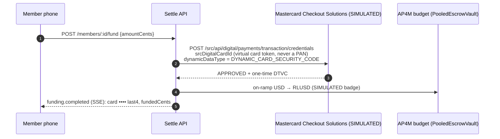

# Settle × Mastercard Agent Pay for Machines

**Track:** Agentic Finance · Mastercard × XRPL Swell Hackathon, New York, Oct 24–25 2026

> **The challenge:** *"Build an AI agent that pays a verified merchant autonomously, within a funded spend limit."*
>
> **Settle's answer:** when a member walks out of their club, their agent settles the tab with the venue in seconds, autonomously, but only inside a Mastercard-verified, prefunded, member-signed limit. Payment is an AP4M EIP-712 Voucher over x402, and it settles in RLUSD.

Hospitality runs on trust: members sign for food and drink and pay later. A single members' club carries $300–400k in outstanding F&B balances, and finance teams spend days reconciling and chasing them. Settle replaces "chase it later" with **"authorize once, settle at the door"**. That is exactly AP4M's model: *authorize once, transact many times, guarantee payment now, settle later.*

| | |
|---|---|
| Repo | `[REPO URL]` (today: https://github.com/jannahsherif/XRPL-hackathon) |
| Video | `[VIDEO URL]` |
| Run it | [README.md › Run the demo](../README.md#run-the-demo) |
| AP4M on XRPL EVM (live) | `[AP4M EXPLORER LINKS]`: not run against the live AP4M service yet (see [Status](#status-whats-real-vs-simulated)) |
| XRPL settlement rail (native token escrow, testnet, 2026-10-25) | Tab escrow [2C13…C032](https://testnet.xrpl.org/transactions/2C13710291EB5C5437F879158308B9DD93826FE370B4C8283D646B6D86A2C032) · settle Batch [FBF1…96DE](https://testnet.xrpl.org/transactions/FBF1C905330ECCC696B5A8F6AAB4607ACF51DB36147697C1BEC9ECF574DF96DE) · held $900 tab, approved and finished [3F03…5BCD](https://testnet.xrpl.org/transactions/3F031ED98D3AB369FF4DFAAF328B03C64F1C0F33ACED9455C30F4250152D5BCD). All links: [COMMONS.md › Proof on testnet](COMMONS.md#proof-on-testnet) |

---

## How Settle uses each AP4M control

| AP4M pillar (deck slides 3, 6) | In Settle | Where | How a judge sees it |
|---|---|---|---|
| **01 Credentialing: Know Your Agent** | The Settle agent, the member (Agent Principal) and the venue (Merchant) are PSP-attested participants in the **ParticipantRegistry**. Channels only open between active participants, and Vouchers are only accepted from the Channel's registered Agent. | `api/src/ap4m/simulatedNetwork.ts`, `liveNetwork.ts` | `GET /ap4m` lists the identities and the PSP that attested each one. `POST /demo/ap4m/unverified-agent/:tab` shows an impostor's Voucher refused with **401** |
| **02 Permissioning: Funded ASL** | Opening a tab opens an **AP4M Channel whose cap is the member's tab allowance**, funded from the budget in **PooledEscrowVault**. The ledger enforces `settled ≤ redeemed ≤ cap`. | `api/src/ap4m/ap4mLedger.ts` (`openTab`) | `tab.ap4m.capRlusd` on every tab, and the `ap4m.channel_opened` event. `POST /demo/ap4m/over-cap/:tab` shows the over-cap attempt **rejected twice**: the Agent refuses to sign, and the PaymentLedger refuses a Voucher signed anyway |
| **03 Transacting: EIP-712 Vouchers over x402** | At settlement the venue answers **HTTP 402** with a `batch-settlement` requirement. The agent checks it against its own authority, then signs a **cumulative EIP-712 Voucher** (domain `AP4M Payment Ledger` v1, chain 1449000). The venue redeems it with `PaymentLedger.redeemVoucher` and releases the tab receipt. | `api/src/ap4m/payer.ts`, `merchant.ts`, `voucher.ts`, `x402.ts` | `x402.payment_required` then `x402.paid` on the live event stream, plus `GET /x402/tabs/:id/resource` (`PAYMENT-REQUIRED` / `PAYMENT-SIGNATURE` / `PAYMENT-RESPONSE` headers) |
| **04 Settling: RLUSD on XRPL** | `settle()` pays `(redeemed − settled)` RLUSD to the venue payout (**ClaimPaid + SettlementRecorded**). `closeChannel()` then returns the unused allowance to the member's budget. | `ap4mLedger.ts` (`settleTab`) | `tab.ap4m.payment` holds the claimId, voucherDigest and the redemption, payout, settlement and close transactions, plus the receipt URL. The dashboard's outstanding counter drops by the settled amount |
| **Verifiable Intent** (credentialing, slide 3) | When a tab opens, the member signs a **Verifiable Intent mandate** for their agent: max = allowance, payee = the venue, expiry = end of night, agent key bound in `cnf`. Before any Voucher is signed, the settlement must fit the mandate, and the agent signs an L3 payment record tying the mandate hash to the cart hash and the amount. | `api/src/intent/mandate.ts` | `intent.mandate_signed` and `intent.verified` events. `GET /intent/tabs/:id` returns the JWS and the member's public key so anyone can verify it. An expired or exceeded mandate holds the tab (`intent.violation`) |
| **Multi-rail: cards** (slide 3, "cards to stablecoins") | Members top up their budget from a **Mastercard card on file**, as a virtual card token (`srcDigitalCardId`, one-time DTVC, never a PAN). The request is shaped like Mastercard Checkout Solutions' `POST /transaction/credentials`, then on-ramped to RLUSD. | `api/src/funding/cardFunding.ts` | `POST /members/:id/fund`, shown with a **SIMULATED** badge (the engineering plan keeps funding and payout simulated and settlement live) |

The design principle: **the model decides, code signs.** The settlement agent (Claude on AWS Bedrock AgentCore) chooses *settle / split / hold* and the tip. It never holds a key. Signing is deterministic code that cannot exceed the Verifiable Intent mandate or the on-chain Channel cap, and the hard hold rules run **before** the LLM is called.

---

## Submission blueprint (deck slide 16)

| Blueprint | How we show it in the 5-minute demo |
|---|---|
| **CONTROL** ✓ PSP-attested identities | `GET /ap4m`: Agent and Principal attested by `mc-payer-psp`, Merchant by `mc-payee-psp` |
| ✓ Funded channel cap | Opening a tab opens a Channel: "cap 6 RLUSD" appears on the tab card |
| ✓ Over-cap attempt rejected | `POST /demo/ap4m/over-cap/:tab` refuses in two places: "price exceeds the Channel cap" from the Agent, and "redeemed must never exceed cap" from the ledger |
| **PAYMENT** ✓ HTTP 402 requirements | `x402.payment_required` event with the challenge (scheme, RLUSD asset, amount, payTo, cumulative watermark) |
| ✓ Agent-signed Voucher | `PAYMENT-SIGNATURE` carries the EIP-712 Voucher, the Agent's signature and the member's mandate hash |
| ✓ Immediate resource release | `200` + `PAYMENT-RESPONSE`, and the tab receipt is released in the same round trip |
| **PROOF** ✓ VoucherRedeemed claim | `tab.ap4m.payment.claimId` and `voucherDigest` |
| ✓ ClaimPaid + SettlementRecorded | `ap4m.settled` event with the payout and settlement transactions |
| ✓ Receipt: channel + claim + payout | Settlement card on the dashboard: channel, claim, payout, close transaction and the AP4M receipt URL (live mode) |

---

## Trust and control (25%): seven independent checks before RLUSD moves

```
 member signs mandate ─► hard rules (pre-LLM) ─► LLM decision ─► mandate check ─► agent authority check ─► ledger: KYA + signature + cap ─► settle
      (Verifiable Intent)   (item > allowance,     (settle/split/   (amount, payee,   (network, asset, ledger,   (ParticipantRegistry,
                            total > 3× typical)     hold, tip)       expiry, agent)    payTo, ≤ max, ≤ cap)      redeemed ≤ cap, idempotent)
```

1. **Verifiable Intent mandate.** The member's own signature defines the limit. It can't be widened by the agent, the venue or Settle.
2. **Hard rules before the model.** The $900 bottle on a member whose typical spend is $120 is held by code, so the hold path never depends on the LLM.
3. **Manager in the loop.** Held tabs wait for approve or reject on the manager's phone.
4. **Agent-side authority check.** Like the AP4M kit's `buyResource`, the agent refuses a challenge with the wrong network, asset, ledger, payout or cumulative watermark, or one above its maximum or the cap. It does this *before signing*.
5. **Funded cap on-chain.** PaymentLedger enforces `settled ≤ redeemed ≤ cap`, and the cap can't exceed RLUSD locked in the vault.
6. **KYA.** Only the Channel's registered, active Agent can produce a redeemable Voucher.
7. **Idempotency.** Retried payments return the same claim and are never redeemed twice. Each tab invoice can be paid once.

Keys: the Agent payment key and the Merchant submitter key are separate from the funding wallet (deck slide 11, "separate funding and payment keys"). They live only in AWS Secrets Manager (`settle/<stage>/ap4m-env`) and are never sent to the AP4M service, which only ever receives signatures.

## Real-world utility (25%)

- **Who pays today:** private clubs, hotels and restaurant groups carry member and guest F&B balances, often six figures per venue (US private clubs alone: about 5,700 venues and about $32.6bn in revenue).
- **What changes:** the tab is pre-authorized at open (Funded ASL plus mandate), and payment is guaranteed the moment the member leaves. There are no month-end statements and no chasing, and reconciliation is automatic because every payment carries a claim ID and receipt.
- **Relationship-safe:** the member never sees a collections flow. They see a push notification with a 10-second grace window to pick a tip or dispute.
- **Machine-speed fit:** a busy venue settles hundreds of tabs a night, and with cumulative Vouchers one Channel can carry many payments. This is the AP4M "authorize once, transact many times" pattern.

## Technical execution (25%)

- **Protocol parity.** The Voucher EIP-712 domain and types match the AP4M kit's `signVoucher` and the deployed PaymentLedger ABI. The x402 challenge fields match the kit's `buyResource` checks. Live mode targets the deployed contracts (`PaymentLedger 0xcAB4…aE91`, `ParticipantRegistry 0x4cF2…D1E8`, `PooledEscrowVault 0x83DD…aBC0`, `RLUSD 0x27b5…16f3`) on XRPL EVM Testnet, chain 1449000.
- **Two networks, one code path.** `AP4M_NETWORK=simulated` enforces the AP4M rules in memory with real secp256k1 EIP-712 signatures, so the demo can't be broken by testnet weather. `AP4M_NETWORK=live` uses the AP4M service (sign-in challenge, channel requests, record-redemption, settle, close) and the PaymentLedger on-chain. Merchant, payer and settlement code are identical in both.
- **Tests.** 460+ automated tests. The AP4M and Mastercard ones are listed below:

  | Suite | Covers |
  |---|---|
  | `ap4m.protocol` | Units, EIP-712 replay protection across chains and ledgers, x402 header codecs |
  | `ap4m.network` | KYA, budget, cap rule, stale vouchers, forged signatures, expiry, settle and close accounting |
  | `ap4m.x402` | 402 shape, the full exchange, idempotency, tampered challenges, 7 agent-side refusal cases |
  | `ap4m.live` | Live client against a fake XRPL EVM node and AP4M service: tx construction, claimId from logs, settle polling, close-checkpoint signature recovery, no private key ever sent |
  | `intent` | JWS, mandate limits, expiry, payee, agent binding, payment-record forgery |
  | `mastercard.integration` | The whole REGISTER → FUND → PAY → SETTLE loop through the HTTP API |

- **Hosted on AWS.** The API runs on ECS Fargate behind CloudFront. The settlement agent runs on Amazon Bedrock AgentCore Runtime. Deploys go through CloudFormation, from GitHub Actions on each release (see [AWS.md](AWS.md)).

## Path to production (15%)

| Step | Change |
|---|---|
| Live AP4M | Onboard the team in the participant portal. Put `AP4M_TEAM_NAME`, `AP4M_AGENT_PRIVATE_KEY`, `AP4M_MERCHANT_SUBMITTER_KEY`, `AP4M_MERCHANT_ID` and `AP4M_MERCHANT_PAYOUT` in `settle/<stage>/ap4m-env`, then deploy with `LEDGER_MODE=ap4m`, `AP4M_NETWORK=live` |
| Real amounts | `AP4M_USD_PER_RLUSD=1`. The demo uses $100 = 1 RLUSD because the hackathon budget is 20 RLUSD |
| One Channel per member | Cumulative Vouchers already support many tabs per Channel. The member's Channel becomes their standing house-account limit |
| Verifiable Intent | Swap the simplified ES256 profile for the SD-JWT reference implementation (`agent-intent/verifiable-intent`), with the member's key held in a phone passkey |
| Card funding | Mastercard Checkout Solutions sandbox (Mastercard Connect order), with Click to Pay or virtual card tokens for top-ups. The request shape is already in `cardFunding.ts` |
| PSP onboarding | The venue's acquirer sponsors Merchant attestation, and the club's issuer or PSP sponsors Agent Principal attestation |
| Disputes | The tab receipt plus the L3 payment record give issuers and venues cryptographic evidence of what was authorized and what was paid |

## Demo and story (10%): 5 minutes

1. **0:00 Problem:** "$342,180 outstanding at one club." The dashboard float counter is visible.
2. **0:30 Register and fund:** `GET /ap4m` shows the PSP-attested identities. Eleanor opens a tab, which opens a Channel capped at her allowance, and she signs her Verifiable Intent mandate. Card top-up shown as SIMULATED.
3. **1:15 Order:** the POS adds five items, and the headroom against the cap updates live.
4. **1:45 Pay:** "Simulate exit" sends a push with a 10-second countdown. The agent decides during grace, then the 402 challenge, the Agent-signed Voucher and the redemption follow. Settled in RLUSD in seconds. Settlement card: claim, payout, receipt. The float counter drops.
5. **3:00 Control:** Jordan's $900 bottle is held by the rule ("over 3× typical"). The manager approves on their phone, and it settles exactly at the 10 RLUSD cap.
6. **3:45 Prove it:** the over-cap probe is refused twice, and the impostor agent is refused with 401.
7. **4:30 Close:** "Verified agent, funded limit, member-signed intent, RLUSD settlement. The model decides, Mastercard trust controls decide whether it can pay."

---

## Sequence diagrams

### The trusted payment loop (REGISTER → FUND → PAY → REDEEM → SETTLE)



### Controls: over-cap, unverified agent, anomaly hold



### Card funding (SIMULATED rail)



---

## Status: what's real vs simulated

| Piece | Status |
|---|---|
| Native XRPL settlement rail (token escrow per tab, Batch settle, `CLUB_MEMBER` credentials) | **Real on XRPL testnet** (`LEDGER_MODE=module`), run end to end on 2026-10-25 (links above). This is the rail the stage demo runs on |
| AP4M rules, EIP-712 Vouchers, x402 exchange, settle and close accounting | **Working end to end** in `AP4M_NETWORK=simulated`, with real signatures and the same domain as the deployed ledger. Exercised by the integration tests and a running server |
| Live XRPL EVM Testnet + AP4M service client | Implemented from the AP4M kit documentation and tested against a faked node and service. **Not yet run against the real service**: that needs the team's portal onboarding and keys |
| Verifiable Intent | Simplified ES256 profile (mandate + L3 record). SD-JWT selective disclosure is the production step |
| Card funding | SIMULATED, per the engineering plan |
| Payout rail (venue cash-out) | SIMULATED, labelled so on the dashboard |
| Member leaving (geofence), POS, push notification | Simulated in the web demo: a "Simulate exit · DEMO" button, a demo terminal standing in for Toast or Lightspeed, and phone frames in the browser |
| AP4M kit code | Not vendored: the integration reimplements the documented protocol with `ethers` |
